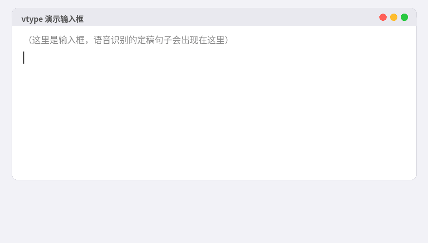

# vtype — 简易流式语音输入法（Linux / Wayland）

按住热键说话，中文文字**实时**流入任意焦点输入框。专为"和 AI 顺畅对话"的场景设计，
在终端、浏览器、编辑器里都能用。

基于阿里云百炼 `qwen3-asr-flash-realtime` 流式语音识别。



## 工作原理

仿照真实输入法的**预编辑 / 提交**模型：

- 说话时的中间结果（会自我修正的部分）只进内存，显示在屏幕底部的**悬浮预览窗**——
  你能实时看到识别和调整的过程
- 一句话定稿后才一次性粘贴进输入框，**只追加、不退格**，
  从机制上杜绝重复、错删、重叠

```
热键(evdev 全局监听) → arecord 录音 → 千问实时 ASR (WebSocket)
   ├─ 中间结果 → 悬浮预览窗 (tkinter, 不抢焦点)
   └─ 定稿句子 → 预览窗进程充当剪贴板属主 + dotool 模拟粘贴键 → 焦点输入框
```

## 环境要求

- Ubuntu 24.04+ / GNOME Wayland（在此环境开发与测试；其他桌面环境未验证）
- Python 3.10+
- 阿里云百炼 API Key（`sk-` 开头，[开通地址](https://bailian.console.aliyun.com/)）

## 安装

一键安装（Ubuntu 24.04+，自动装系统依赖、编译 dotool、加用户组、建 venv）：

```bash
git clone https://github.com/alisx/vtype.git && cd vtype
bash install.sh
```

装完按提示设置 API Key 即可。如果习惯自己动手，手动步骤如下：

```bash
# 1. 系统依赖
sudo apt install alsa-utils wl-clipboard git golang-go gcc libxkbcommon-dev scdoc python3-tk

# 2. dotool（Ubuntu 源里没有，从源码编译）
cd /tmp && git clone https://git.sr.ht/~geb/dotool
cd dotool && ./build.sh && sudo ./build.sh install

# 3. 把当前用户加入 input 组（热键监听和文字注入都需要），然后注销重新登录
sudo usermod -aG input $USER

# 4. 本项目依赖
python3 -m venv .venv
.venv/bin/pip install -r requirements.txt
```

## 使用

```bash
export DASHSCOPE_API_KEY="sk-你的百炼Key"
.venv/bin/python vtype.py                 # 按住 ScrollLock 说话，松开出字
```

选项：

```bash
.venv/bin/python vtype.py --key F9           # 换热键
.venv/bin/python vtype.py --paste-key ctrl+v # 个别应用不认 shift+insert 时用
.venv/bin/python vtype.py --test-injection   # 只测文字注入和预览窗（不用说话）
.venv/bin/python vtype.py --dry-run          # 只打印识别结果，不注入
.venv/bin/python vtype.py --debug            # 打印所有 ASR 事件，排障用
```

## 开机自启（可选）

```bash
# 先在 vtype.service 里填入 API Key
mkdir -p ~/.config/systemd/user
cp vtype.service ~/.config/systemd/user/
systemctl --user enable --now vtype
```

## 故障排查

| 现象 | 排查 |
|---|---|
| 按热键没反应 | `groups` 里确认有 `input`；确认已注销重登 |
| 识别正常但打不进字 | 换 `--paste-key`；终端里默认的 shift+insert 一般可用 |
| 连接失败警告 | 网络问题，程序会自动重试一次；检查是否能访问 dashscope.aliyuncs.com |
| 断句太急/太慢 | 调 `vtype.py` 顶部的 `VAD_SILENCE_MS`（默认 1200ms），改完重启生效 |
| 看完整事件流 | `--debug` |

## 注意

- 与其他语音输入工具（如 VoxType）不要设同一个热键
- 注入使用剪贴板中转，会覆盖剪贴板内容（由内置预览窗进程充当剪贴板属主）
- 语音数据会发送到阿里云识别，请按需权衡隐私

## 关注作者

欢迎扫码关注我的公众号，一起交流：


## License

MIT
